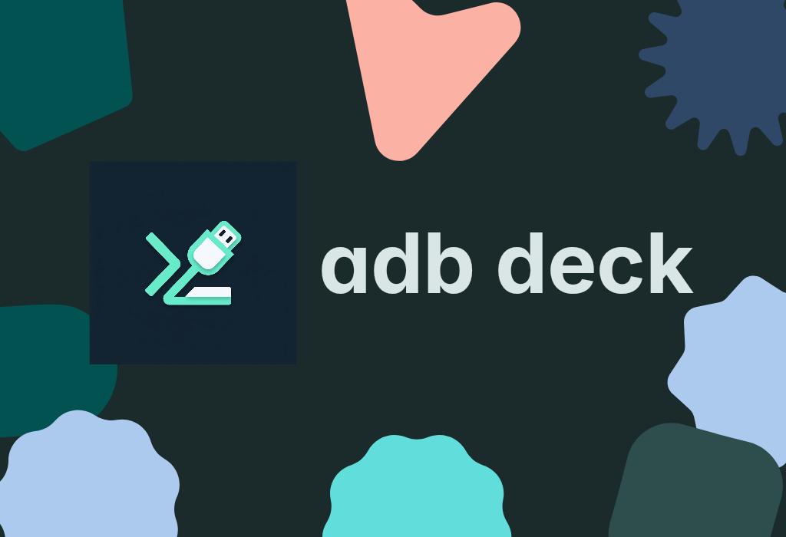

  

# ADB Deck 

[🇷🇺 Русский](#-русский) | [🇬🇧 English](#-english)

---

## 🇷🇺 Русский это вайбкод 

**ADB Deck** — это нативный Android-клиент Android Debug Bridge (ADB) на Kotlin и Jetpack Compose (Material 3), позволяющий управлять другими Android-устройствами без root-прав и компьютера.

### 🛡️ Безопасность и приватность

* **Никаких вирусов и скрытых модулей:** полностью открытый исходный код (Open Source), который вы можете проверить и собрать самостоятельно.
* **Минимум разрешений:** приложение **не запрашивает** опасные или лишние права — никакого доступа «поверх других окон» (Overlay), специальных возможностей (Accessibility), геолокации, контактов или SMS.
* **Локальная работа:** вся генерация RSA-ключей и передача команд происходят напрямую между вашими устройствами по USB или локальной сети без отправки данных на сторонние серверы.

### ✨ Ключевые возможности

* **🔌 Подключение (Connect Hub):**
  * **TCP/IP и Wi-Fi:** подключение по IP и порту (`192.168.x.x:5555`), поддержка вставки команды `adb connect`, поиск устройств в локальной сети через mDNS / NSD.
  * **USB OTG:** прямое подключение к другому смартфону по кабелю через USB Host API.
  * **Управление сессией:** перевод USB в беспроводной режим (`adb tcpip 5555`), перезагрузка в System, Bootloader, Recovery или Fastbootd.
* **💻 Терминал и Управление:**
  * **Shell:** выполнение любых команд, быстрые пресеты (`getprop`, `dumpsys`, `ip addr` и др.), история команд и замер времени отклика.
  * **Logcat:** просмотр системных логов в реальном времени с фильтрацией по уровню (`V/D/I/W/E`) и очисткой буфера.
  * **Пульт и Экран:** эмуляция кнопок навигации и громкости, удаленный ввод текста и снятие скриншотов в PNG.
* **📦 Менеджер приложений (Packages):**
  * Фильтрация (Все / Пользовательские / Системные / Отключенные) и поиск пакетов.
  * Запуск, остановка (`force-stop`), очистка кэша/данных, заморозка, удаление (включая системный bloatware для текущего пользователя) и установка локальных `.apk` файлов.
* **🛠 Инструменты и Файлы:**
  * **Файловый менеджер (`/sdcard`):** загрузка, скачивание и удаление файлов по бинарному протоколу `sync`.
  * **Твики экрана и Сводка:** информация об устройстве, изменение разрешения (`wm size`), плотности (`wm density`) и скорости анимаций.
  * **Справочник команд:** база команд ADB по 9 категориям с поиском, описанием и быстрым запуском.
* **🎨 Интерфейс Material You:**
  * Динамические цвета (Android 12+), 6 встроенных палитр, светлая, темная и AMOLED-темы, настройка скругления карточек и размера шрифта терминала.
  * Адаптивная верстка для смартфонов и планшетов, мгновенное переключение языка (`RU / EN`).

### ⚙️ Под капотом
* **Pure Kotlin ADB:** собственная реализация бинарного протокола ADB (`CNXN`, `AUTH`, `OPEN`, `OKAY`, `WRTE`, `CLSE`), мультиплексирования потоков и `sync`-обмена.
* **Безопасность:** генерация 2048-битных RSA-ключей и подпись токенов аутентификации прямо на устройстве.
* **Стек:** Kotlin, Jetpack Compose, Material 3, MVVM, Room, DataStore Preferences, Android USB Host & NSD API.

---

## 🇬🇧 English

**ADB Deck** is a native Android Debug Bridge (ADB) client built with Kotlin and Jetpack Compose (Material 3). It lets you manage and debug other Android devices directly from your phone or tablet—no root or PC required.

### 🛡️ Security & Privacy

* **Clean & Transparent:** 100% open-source codebase with zero malware, trackers, or hidden background services.
* **No Invasive Permissions:** The app **does not request** intrusive permissions such as "Display over other apps" (Overlay), Accessibility Services, Location, Contacts, or SMS.
* **100% Local:** All RSA key generation and ADB traffic stay strictly between your devices over USB or your local Wi-Fi network—nothing is ever sent to external servers.

### ✨ Key Features

* **🔌 Connect Hub:**
  * **TCP/IP & Wi-Fi:** Connect via IP/port (`192.168.x.x:5555`), auto-parse pasted `adb connect` strings, and discover local devices via mDNS / NSD.
  * **USB OTG:** Connect directly to target devices over cable using the Android USB Host API.
  * **Session Control:** Switch USB devices to wireless mode (`adb tcpip 5555`) and reboot into System, Bootloader, Recovery, or Fastbootd.
* **💻 Terminal & Remote Control:**
  * **Shell:** Execute any shell command with quick chips (`getprop`, `dumpsys`, `ip addr`, etc.), command history, and execution timer.
  * **Logcat:** View live system logs with level filtering (`V/D/I/W/E`), text search, and buffer clearing.
  * **Remote & Screen:** Send hardware key events (Back, Home, Power, Volume), input text remotely, and capture device screenshots (`screencap`) as PNG.
* **📦 Package Manager:**
  * Filter installed apps (All / User / System / Disabled) with live search.
  * Launch, force-stop, clear data/cache, disable/enable, uninstall apps (including system bloatware via `--user 0`), and install local `.apk` files.
* **🛠 Tools & File Explorer:**
  * **File Manager (`/sdcard`):** Browse, push, pull, and delete files over the binary ADB `sync` protocol.
  * **Display Tweaks & Info:** View hardware/OS specs, modify screen resolution (`wm size`), DPI (`wm density`), and animation scales.
  * **Command Reference:** Built-in catalog of ADB commands across 9 categories with descriptions and one-tap execution.
* **🎨 Material You Design:**
  * Dynamic colors (Android 12+), 6 built-in color palettes, Light/Dark/AMOLED themes, customizable corner radius, and adjustable monospace terminal font size.
  * Adaptive layout for phones and tablets with instant language switching (`EN / RU`).

### ⚙️ Under the Hood
* **Pure Kotlin ADB:** Custom implementation of the binary ADB protocol (`CNXN`, `AUTH`, `OPEN`, `OKAY`, `WRTE`, `CLSE`), stream multiplexing, and `sync` file transfer.
* **Security:** On-device 2048-bit RSA key pair generation and challenge token signing.
* **Tech Stack:** Kotlin, Jetpack Compose, Material 3, MVVM, Room, DataStore Preferences, Android USB Host & NSD API.
